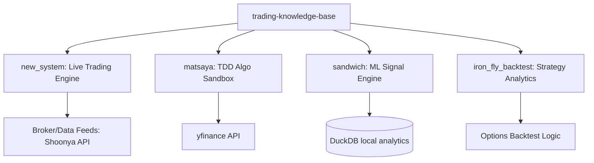

# Architecture Diagram: Trading Knowledge Base

This repository operates as an ensemble of distinct trading pipelines running autonomously on crontab (`crontab.txt`) against external services API and local Data Warehouses (`duckdb`).